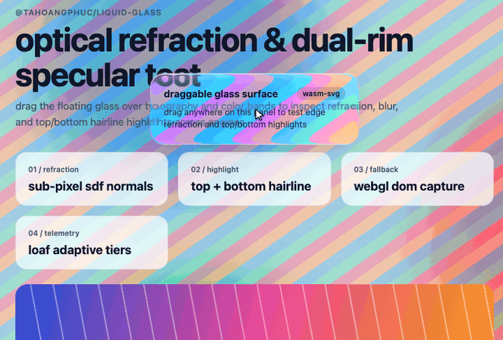

# liquid-glass

Optical refraction and glass displacement for Vanilla JS, React, and Vue 3.

Uses WebAssembly (WASM SIMD) displacement maps on Chromium desktop, and falls back to WebGL scene capture or CSS backdrop filters on mobile and Safari.



## Installation

```bash
npm install @tahoangphuc111/liquid-glass
```

Import base styles once in your root stylesheet or entry file:

```ts
import "@tahoangphuc111/liquid-glass/styles.css";
```

## Quick Start

### Vanilla JavaScript

```ts
import { createLiquidGlass } from "@tahoangphuc111/liquid-glass";

const element = document.querySelector<HTMLElement>(".glass-card")!;

const glass = createLiquidGlass(element, {
  surface: "convex_squircle",
  thickness: 40,
  bezel: 24,
  ior: 1.45,
  blur: 2,
  interactive: true
});

// Update options at runtime
glass.update({ thickness: 50 });

// Clean up when removing the element
glass.destroy();
```

### React

Wrap components with `<LiquidGlass>` or use the `useLiquidGlass` hook:

```tsx
import { LiquidGlass } from "@tahoangphuc111/liquid-glass/react";

export function GlassCard() {
  return (
    <LiquidGlass
      surface="convex_squircle"
      thickness={40}
      bezel={24}
      ior={1.45}
      interactive
      className="p-6 rounded-2xl"
    >
      <h2>Refracted Card</h2>
      <p>Content rendered inside liquid glass container.</p>
    </LiquidGlass>
  );
}
```

Or using the hook directly:

```tsx
import { useRef } from "react";
import { useLiquidGlass } from "@tahoangphuc111/liquid-glass/react";

export function CustomCard() {
  const ref = useRef<HTMLDivElement>(null);

  useLiquidGlass(ref, {
    surface: "convex_circle",
    pill: true,
    interactive: true
  });

  return <div ref={ref} className="p-4">Pill button</div>;
}
```

### Vue 3

Register as a global plugin or import components directly:

```vue
<script setup lang="ts">
import { LiquidGlass } from "@tahoangphuc111/liquid-glass/vue";
</script>

<template>
  <LiquidGlass
    surface="convex_squircle"
    :thickness="40"
    :bezel="24"
    :interactive="true"
    class="glass-panel"
  >
    <span>Vue Liquid Glass Panel</span>
  </LiquidGlass>
</template>
```

Or with the composable:

```vue
<script setup lang="ts">
import { ref } from "vue";
import { useLiquidGlass } from "@tahoangphuc111/liquid-glass/vue";

const panelRef = ref<HTMLElement | null>(null);

useLiquidGlass(panelRef, {
  surface: "convex_squircle",
  thickness: 35
});
</script>

<template>
  <div ref="panelRef" class="glass-box">Content</div>
</template>
```

## How It Works

1. **Chromium Desktop (`wasm-svg`)**: Calculates refraction displacement using a WebAssembly SIMD kernel and outputs dynamic displacement maps directly into SVG `feDisplacementMap` filters.
2. **Mobile and Safari (`webgl`)**: When full SVG refraction is unsupported, samples background DOM elements onto a canvas or offscreen buffer and applies real-time GLSL fragment shaders.
3. **Low-power or fallback (`css`)**: Automatically steps down to CSS `backdrop-filter` if the GPU drops frames or battery-saving mode is active.

## Configuration Options

| Option | Type | Default | Description |
| :--- | :--- | :--- | :--- |
| `surface` | `"convex_squircle" \| "convex_circle" \| "linear" \| "lip"` | `"convex_squircle"` | Geometric refraction profile. |
| `engine` | `"auto" \| "wasm-svg" \| "webgl" \| "css"` | `"auto"` | Execution engine. `auto` picks the best supported engine. |
| `thickness` | `number` | `40` | Virtual lens thickness in pixels. |
| `bezel` | `number` | `24` | Width of the refraction boundary edge in pixels. |
| `ior` | `number` | `1.45` | Index of refraction. 1.0 is air, 1.33 is water, 1.5 is glass. |
| `blur` | `number` | `0` | Gaussian blur radius applied behind the displacement filter. |
| `radius` | `number` | `24` | Corner radius override in pixels. Defaults to element border radius. |
| `pill` | `boolean` | `false` | Locks corners to full pill or circular shape. |
| `hollow` | `boolean` | `false` | Keeps inner area flat and limits refraction only to bezel edges. |
| `interactive` | `boolean` | `false` | Enables spring physics on cursor hover and click. |
| `tintColor` | `string` | `undefined` | Overlay tint color in hex or rgb format. |
| `tintOpacity` | `number` | `0` | Opacity of the tint layer (0 to 1). |
| `sceneElement` | `HTMLElement` | `null` | Target DOM element to sample for WebGL refraction mode. |
| `onEngineChange` | `(engine: GlassEngine) => void` | `undefined` | Callback fired when engine resolves or falls back. |

## Development

```bash
# Install dependencies
npm install

# Start local interactive playground
npm run dev

# Run unit tests
npm test

# Rebuild the Rust WASM SIMD kernel and update src/core/wasm.ts (requires rustup + wasm32-unknown-unknown)
npm run build:wasm

# Build package
npm run build
```

## License

MIT
